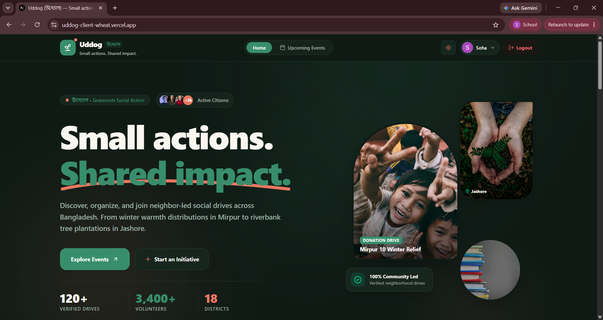
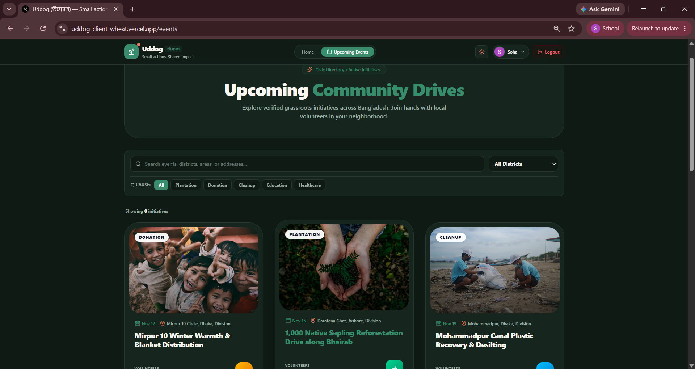

# উদ্যোগ (Uddog)
### Small actions. Shared impact.

Uddog is a community-driven social development platform that connects people with meaningful initiatives and encourages them to participate in positive social change.

Whether it's organizing a tree plantation drive, joining a cleanup campaign, supporting donations, or contributing to educational and healthcare initiatives, Uddog makes community participation easier.

🌐 **Live Website:** https://uddog-client-wheat.vercel.app/

## ✨ Key Features

- User Authentication: Register and sign in using email/password or Google authentication.
- Explore Initiatives: Browse upcoming social development events and view detailed information about each initiative.
- Category Filtering: Discover initiatives based on categories such as Plantation, Donation, Cleanup, Education, and Healthcare.
- Create Initiatives: Authenticated users can organize and publish their own social development events.
- Join Initiatives: Users can register to participate in available events.
- Event Management: Organizers can view, edit, and manage their own initiatives.
- Protected Routes: Authentication is required to access organizer-specific features.
- Responsive Design : Access the platform across desktop, tablet, and mobile devices.

## 🛠️ Technology Stack

### Frontend
- Next.js (App Router)
- React
- TypeScript
- Tailwind CSS
- Better Auth
- Lucide React
- heroUi

### Backend
- Node.js
- Express.js
- MongoDB
- Better Auth JWT
- JOSE

### Deployment
- Frontend: Vercel
- Backend: Render
- Database: MongoDB Atlas

## 🚀 Getting Started

Follow these instructions to run the frontend locally.

### Prerequisites

- Node.js
- npm
- Git

### 1. Clone the repository

git clone https://github.com/Soha-Tabassom-Supre/uddog-client.git
git clone https://github.com/Soha-Tabassom-Supre/uddog-server.git

### 2. Navigate to the project directory

cd uddog-client

### 3. Install dependencies

npm install

### 4. Configure environment variables

Create a `.env` file in the project root:

env
NEXT_PUBLIC_API_URL=http://localhost:5000

BETTER_AUTH_URL=http://localhost:3000
BETTER_AUTH_SECRET=your_better_auth_secret

MONGODB_URI=your_mongodb_connection_string
DB_NAME=your_database_name

GOOGLE_CLIENT_ID=your_google_client_id
GOOGLE_CLIENT_SECRET=your_google_client_secret

Use the variable names and database configuration expected by your actual `src/lib/auth.ts` file.

**Important:** Never commit your `.env` file or expose credentials in your repository.

### 5. Run the development server

npm run dev

Open http://localhost:3000 in your browser.

## 🎨 Design Direction

Uddog uses a warm, modern editorial design approach.

- Deep forest green as the primary brand color.
- Warm ivory backgrounds for a welcoming appearance.
- Coral accents to highlight important actions.
- Responsive layouts and reusable UI components.

## 📸 Screenshots

 ### Homepage
 
 

### Explore Initiatives

### Goal 

We believe meaningful social change starts with small actions.

Uddog aims to make it easier for people to discover opportunities, collaborate with their communities, and turn good intentions into real-world impact.

**Small actions. Shared impact.**
